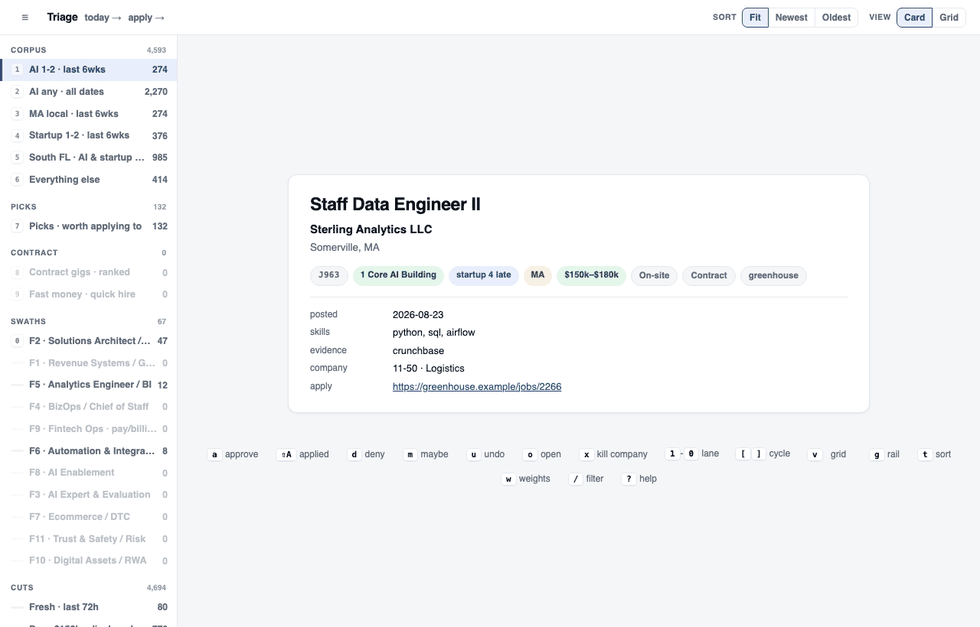
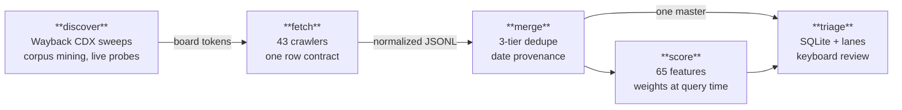

# job-net

[](https://github.com/MichaelFornal/job-net/actions/workflows/ci.yml)

A job-market crawler and triage system. It harvests postings from **43
applicant-tracking systems**, merges them into one deduplicated corpus, tracks
how much it should trust each posting's date, and serves the result as a
keyboard-driven review app.

**~66,000 lines of Python. Four third-party dependencies.** Everything else is
the standard library: `sqlite3` for storage, `http.server` for the web app,
`concurrent.futures` for the crawlers.



*Recorded against `make demo` — synthetic data, no corpus, no keys. Keyboard
approve/deny, the grid view, then the scout panel: every weight is a slider, and
the `why` line on each card is the same arithmetic, so it moves with them.*

| | |
|---|---|
| Crawlers | 43 fetchers, 21 board-discovery / liveness probes |
| Corpus | 6,940,011 unique postings after dedupe in the private deployment *(counted 2026-10-08)* |
| Dedupe | 3-tier key; URL canonicalization across 38 ATS host patterns |
| Triage app | 28 lanes, vanilla JS, no build step, stdlib HTTP server |
| Scoring | 65 orthogonal features, re-ranked in one matrix multiply |
| Tests | 265 assertions + a synthetic-corpus end-to-end suite |
| Dependencies | `requests`, `openpyxl`, `numpy`, `defusedxml` |

> The corpus itself is not in this repo — it is multi-GB and is *reproduced* by
> running the pipeline, not distributed. Everything below runs without it.

---

## Run it in two minutes

No API keys, no corpus, no network:

```sh
pip install -r requirements.txt
make demo            # seeds a synthetic database, serves http://127.0.0.1:8766
```

`make demo` generates a synthetic feed (`triage/fixture.py`), runs the real
loader and all five lane builders over it, builds a small scout corpus and its
index, then starts the review UI. Nothing in that path touches a real job board
— and it is the *real* code end to end, not a mock of it.

To watch the crawler half against a real public endpoint:

```sh
make fetch-demo      # one unauthenticated Greenhouse board, ~10 seconds
```

And the tests, all of which build their own data in a temp directory:

```sh
make test
```

---

## How it fits together



**discover** — you cannot crawl a board you do not know exists. Three
independent channels find them: Wayback CDX sweeps over a declarative registry
of ATS apex domains (`slug_common.py`), mining tenant ids out of the finished
corpus's apply URLs (`ats_mine_tenants.py`), and an open-ended host census that
reports what is in the corpus *minus* what already has a crawler
(`host_census.py`) — so an unpiped platform shows up as a gap instead of
staying invisible.

**fetch** — 43 crawlers, each writing append-only JSONL against one normalized
row contract (`contract_common.py`). 49 modules import it; that shared shape is
the only reason a single dedupe pass downstream can merge them. What is
deliberately *not* shared is the rate policy: every ATS gets its own throttle,
because they have different limits and one global budget would be wrong for all
of them.

**merge** — `all_jobs_build.py` collapses the sources on a 3-tier key: a
canonical `ats|platform|org|id` parsed from the apply URL where one can be
parsed, then company+title+URL, then company+title+location. It also decides
how much to trust each posted date (`date_basis.py`) — only about 43% of rows
carry the employer's own, and the rest are labelled rather than believed.

**triage** — `triage/` is a stdlib `ThreadingHTTPServer` and one 86KB
hand-written HTML file, bound to localhost. A lane is a SQL predicate and
nothing more, so the number beside a lane is exactly the work remaining.
Decisions carry forward across rebuilds on a `company|title` key, because the
primary key is not stable between runs.

**score** — `score_features.py` extracts what is *true* about a row;
`score_profile.py` holds what it is *worth*. Splitting those means weights can
change at query time without recomputing anything, and the whole corpus
re-ranks on a slider. Two implementations, a numpy matrix path and a readable
SQL one, are asserted to agree exactly (`score_profile.py --verify`).

---

## The engineering notes

The most useful thing here is probably not the code — it is
**[docs/notes/](docs/notes/index.md)**: eleven write-ups of things that broke
in production, each with the measurement that found it and the invariant that
fixed it.

- [A done flag is not a refresh policy](docs/notes/01-a-done-flag-is-not-a-refresh-policy.md) — 71,592 boards all marked done, 88 rows fetched, eight outputs byte-identical to the previous run
- [`posted` is not a posting date](docs/notes/02-posted-is-not-a-posting-date.md) — 57% of rows stamped with today's date were not posted today
- [No ATS agrees on what dead looks like](docs/notes/03-no-ats-agrees-on-what-dead-looks-like.md) — one platform ships "no longer available" on *every* page, so naive matching scored 9 of 10 live rows dead
- [A throttle penalty with no decay is permanent](docs/notes/04-a-throttle-penalty-with-no-decay-is-permanent.md) — doubling the request rate *halved* throughput
- [A closed regex list cannot find what it does not list](docs/notes/06-a-closed-regex-list-cannot-find-what-it-does-not-list.md)

---

## Configuration

`profile.example.json` holds the tunable half — target titles, domain
vocabulary, exclusions, commute rings, seniority band. Copy it to
`profile.json` and edit; the code falls back to the example so a fresh clone
runs with no setup.

The split is deliberate: **preferences are data, gates are code.** Which titles
you want is configuration. That a posting for a summer intern or a forklift
operator is not a software role is not — nobody should have to re-derive that.

The worked example cuts to Massachusetts + US-remote + South Florida
(`ma_remote_build.py`). Those are example regions; `BUCKET_RANK` and `geo_of()`
are where you would put your own.

## Testing

```sh
python3 triage/selftest.py         # 265 assertions over load / carry-forward / lanes
python3 triage/scout_selftest.py   # corpus -> index -> score -> cards, end to end
python3 score_profile.py --verify  # the numpy path must equal the SQL definition
```

Every suite builds synthetic data in a temp directory. `triage/selftest.py`
skips six assertions that need the statistical shape of a real corpus cut and
says which — a skipped assertion still states what it would check.

## Responsible use

This crawls **public, unauthenticated** job-board endpoints — the same pages
and documented APIs a browser gets. It does not log in, bypass authentication,
solve captchas, or read anything it was not served. Every crawler rate-limits
per platform and backs off on 429, and the backoff decays rather than
ratcheting. No applicant data is collected; the only personal information
anywhere in the pipeline is your own search preferences, in a file that is
gitignored.

Harvested board and tenant inventories are deliberately **not** published here.
The discovery *method* is, and it reproduces them.

## Known rough edges

No type hints, no packaging — modules sit flat at the root and import each
other by name. Tests are hand-rolled `ok()`-and-exit-code scripts rather than
pytest. That is a real trade and it is visible: the effort went into measuring
behaviour and writing down why, not into ceremony.

## License

MIT — see [LICENSE](LICENSE).
